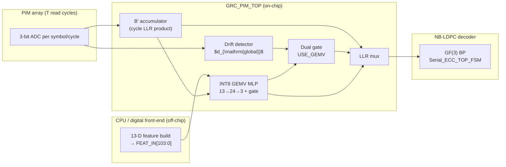
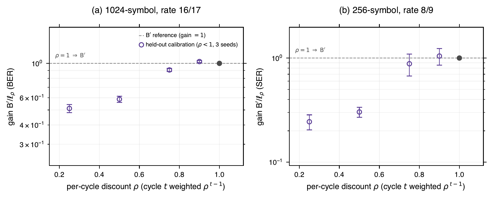
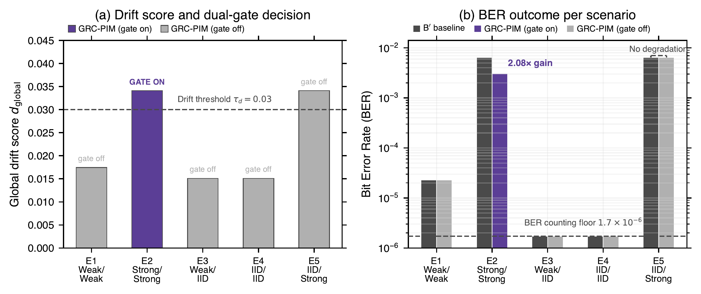
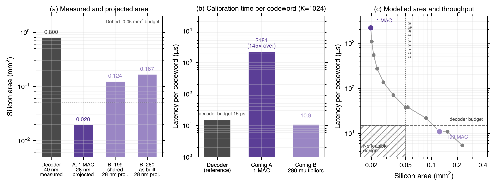

# GRC-PIM / GRC-PIM-IR

**Gated Residual Calibration for soft-decision error correction in RRAM processing-in-memory (PIM).**

Public code and data for the npj manuscript:

> *GRC-PIM: A Drift-Gated, GEMV-Reusing Residual Calibrator for Soft-Decision Error Correction in Processing-in-Memory*

Repository: [github.com/chenxingqiang/GRC-PIM](https://github.com/chenxingqiang/GRC-PIM)

---

## CiM-ResLDPC (SIGIR-AP 2026 track) — IR extension

This tree also hosts **CiM-ResLDPC**: residual error–calibrated robust **edge RAG** on NOR Flash / PIM CiM, reusing the GRC-PIM noise + gated residual stack as retrieval soft evidence.

| Item | Location |
|------|----------|
| Package | [`cim_resldpc/`](cim_resldpc/) |
| Design | [`docs/design/CIM_RESLDPC_DESIGN.md`](docs/design/CIM_RESLDPC_DESIGN.md) |
| Paper drafts | [`docs/paper/`](docs/paper/) (abstract, related work, experiments, test report) |
| Offline eval | `PYTHONPATH=. python3 -m cim_resldpc.experiments.run_sigir_eval` |
| Extended eval (v1.2) | `PYTHONPATH=. python3 -m cim_resldpc.experiments.run_extended_eval --nor nor_typical` |
| HF MiniLM eval (v1.3) | `pip install -r cim_resldpc/requirements-ir.txt && PYTHONPATH=. python3 -m cim_resldpc.experiments.run_hf_eval` |
| Scaled BGE / Flan (v1.4) | `PYTHONPATH=. python3 -m cim_resldpc.experiments.run_scaled_eval --encoder bge --n_queries 200` |
| Ablations (v1.5) | `PYTHONPATH=. python3 -m cim_resldpc.experiments.run_ablation_v15 --encoder bge` |
| MSMARCO 500q (v1.6) | `...run_ablation_v15 --n_queries 500 --emb_cache cim_resldpc/data/cache/bge_msmarco_n500_emb.npz` |
| Tests | `PYTHONPATH=. python3 -m pytest cim_resldpc/tests -v` |

English title: *CiM-ResLDPC: Residual Error Calibrated Robust Retrieval-Augmented Generation on NOR Flash Compute-in-Memory Arrays*.

---

## What problem does GRC-PIM solve?

RRAM PIM arrays suffer from **conductance drift** and **read noise**. Classical GF(3) NB-LDPC decoding (Shi et al.) uses **single-cycle hard decisions** and misses **multi-cycle temporal evidence**. GRC-PIM adds a **compact INT8 GEMV residual calibrator** (425 parameters) on top of the training-free **B′** multi-cycle soft-LLR baseline—but only when a **dual gate** says it is safe:

**Drift gate** — global temporal disagreement exceeds a calibrated threshold:

$$
d_{\mathrm{global}} \;\ge\; \tau_d
\qquad\text{with}\qquad
d_{\mathrm{global}} = \frac{4}{nk}\sum_{i=1}^{n}\mathrm{Var}_{t=1..T}\!\bigl(b_{i,t}\bigr) \in [0,1]
$$

where $b_{i,t}\in\{0,1\}$ is bit $i$ at PIM read cycle $t$ ($T$ cycles, $n$ bits per codeword).

**Model-confidence gate** — mean per-symbol MLP gate confidence exceeds a fixed threshold:

$$
\bar g \;\ge\; \tau_g
\qquad\text{with}\qquad
\bar g = \frac{1}{n}\sum_{i=1}^{n} g_i,
\quad g_i = \sigma\!\bigl(\mathbf{w}_g^{\mathsf T}\mathbf{f}_i + b_g\bigr) \in (0,1)
$$

where $\mathbf{f}_i$ is the 13-D GEMV feature vector for symbol $i$.

Both gates must **open** (AND logic). Paper defaults: $\tau_d = 0.030$ (E2 ablation tables use $\tau_d = 0.025$), $\tau_g = 0.6$.

$$
\mathrm{USE\_GEMV} = \mathbb{1}\!\left[d_{\mathrm{global}} \ge \tau_d\right] \;\land\; \mathbb{1}\!\left[\bar g \ge \tau_g\right]
$$

If either gate closes, output **equals B′ by construction** (no extra error risk).

This repository ships everything needed to **run the simulator, inspect paper numbers, retrain models, and cosim the RTL**. Paper figures are included as **high-resolution PNG** under [`figures/`](figures/) (see below).

---

## System architecture

GRC-PIM sits **between multi-cycle PIM readout and the GF(3) NB-LDPC BP decoder**. It reuses the training-free **B′** multi-cycle soft-LLR product as an anchor, optionally adds a **residual INT8 GEMV correction** $\Delta\mathrm{LLR}$, and falls back to B′ whenever the dual gate closes.


### End-to-end data flow



**Four-stage pipeline** (paper Fig. 1):

| Stage | Block | Input → output | Role |
|-------|-------|----------------|------|
| **1** | Multi-cycle PIM readout | stored weights → $T$ ADC streams | Captures drift + read noise over time |
| **2** | B′ soft-LLR (`GRC_MESSAGE_TRANS` + accumulator) | per-cycle 3-bit LLR → anchor $\mathrm{LLR}_{B'}$ | Training-free baseline; always computed |
| **3** | Gated GEMV calibrator | $\mathrm{LLR}_{B'}$ + 13-D features → $\Delta\mathrm{LLR}$ | 425-param INT8 MLP ($13{\to}24{\to}3$ + gate head); active only if $\mathrm{USE\_GEMV}=1$ |
| **4** | GF(3) BP decoder | prior LLR bus → decoded symbols | `deps/NBLDPC_PIM/` parity-check propagation |

Parallel **control paths** (not on the main LLR bus):

- **Drift detector** (`DRIFT_DETECTOR_CODEWORD`) — computes $d_{\mathrm{global}}$ from cross-cycle bit disagreement.
- **Model-confidence gate** — $\bar g$ from per-symbol sigmoid outputs of the GEMV head.

### Output mux (safe fallback)

Per symbol $i$, the emitted prior is:

$$
\mathrm{LLR}_i =
\begin{cases}
\mathrm{LLR}_{B',i} + \Delta\mathrm{LLR}_i & \mathrm{USE\_GEMV} = 1 \\
\mathrm{LLR}_{B',i} & \mathrm{USE\_GEMV} = 0
\end{cases}
$$

When the gate closes, GRC-PIM is **bit-identical to B′** — no un-gated MLP path reaches the decoder.

### On-chip vs off-chip split

| Location | Responsibility | Repo reference |
|----------|----------------|----------------|
| **PIM + ADC** | $T$-cycle conductance readout, 3-bit quantization | `core/noise3d.py` (simulation channel) |
| **CPU / front-end** | 13-D feature extraction, INT8 quantize, stream on `FEAT_IN` | `hw/feat.py`, [`hw/FEATURE_OFFLOAD.md`](pim_predecoder/hw/FEATURE_OFFLOAD.md) |
| **GRC silicon** | B′ accumulate, drift score, INT8 GEMV, dual gate, LLR emit | `rtl/GRC_PIM_TOP.v`, `rtl/INT8_GEMV_MLP.v` |
| **ECC backend** | Prior mux into full codeword LLR bus → BP decode | `rtl/GRC_ECC_PRIOR_MUX.v`, `deps/NBLDPC_PIM/` |

Default RTL thresholds (1024-scale): `TAU_D_Q16 = 1638` ($\tau_d \approx 0.025$), `TAU_G_Q16 = 39321` ($\tau_g = 0.6$).

### Code map (simulation ↔ RTL)

| Architecture block | Python | Verilog |
|--------------------|--------|---------|
| Multi-cycle noise + readout | `core/noise3d.py` | (testbench stimulus) |
| B′ soft-LLR product | `core/codec.py`, `hw/llr.py` | `GRC_LLR_LUT.v` |
| 13-D features | `core/gemv_calibrator.py`, `hw/feat.py` | off-chip → `FEAT_IN` |
| Drift + dual gate + GEMV | `core/gemv_calibrator.py` | `DRIFT_DETECTOR_CODEWORD.v`, `INT8_GEMV_MLP.v`, `GRC_PIM_TOP.v` |
| Weight export | `hw/export_weights.py` | `rtl/Weights/*.hex` |
| Prior mux + decode cosim | `cosim/cascade.py`, `cosim/decode.py` | `GRC_ECC_PRIOR_MUX.v` + `Serial_ECC_TOP_FSM.v` |

See **Fig. 1** below for the paper diagram and Step 0 smoke-test commands.

---

## Who is this for? Potential use directions

GRC-PIM is a **reliability layer between PIM readout and a soft-decision channel decoder**, not a standalone inference framework. Typical ways to use this repo:

| Direction | What you do here | Entry point |
|-----------|------------------|-------------|
| **Algorithm / ECC research** | Sweep \(p_\mathrm{bit}\), code rate (256 vs 1024), gates, and baselines; compare BER/SER to bundled JSON | Fig. 2 → `experiments/gemv.py`, `experiments/ablation.py` |
| **PIM noise & drift study** | Replay E1–E5 (weak/strong drift, i.i.d., train/test mismatch); tune \(\tau_d\), \(\tau_g\) | Fig. 3 → `results/paper1024_E*.json`, supplementary threshold JSON |
| **Safe AI-assisted correction** | Show gated fallback to B′ under mismatch (E5) vs un-gated degradation | Fig. 3 / `E5_mlp_only_no_gates.json` |
| **Silicon / RTL integration** | Export INT8 GEMV weights, cosim `GRC_PIM_TOP` → NB-LDPC `ECC_TOP`, verify LLR bus | Fig. 4 → `hw/export_weights.py`, `cosim/`, `rtl/` |
| **System co-design** | Split work between **CPU feature build** (13-D/symbol) and **on-chip GEMV + drift gate** | [`pim_predecoder/hw/FEATURE_OFFLOAD.md`](pim_predecoder/hw/FEATURE_OFFLOAD.md) |
| **End-to-end accuracy context** | Use bundled ResNet-18 / CIFAR-10 numbers as a downstream metric (ECC + inference) | Fig. 5 → `inference_accuracy.json` |
| **Port to another PIM technology** | Keep B′ + dual-gate stack; retrain GEMV on new noise model; recalibrate \(\tau_d\) | `core/noise3d.py`, `experiments/gemv.py`, `drift_calibration.json` |

**Not the primary focus of this release:** training full neural networks, CIFAR dataset hosting, or manuscript figure generation—the bundled artifacts target **GF(3) NB-LDPC + multi-cycle PIM ECC** reproducibility and hardware reference.

### About `FEATURE_OFFLOAD.md`

**Worth keeping** if you touch RTL or system integration. It records an intentional design choice: the **13-D GEMV input features are built off-chip** (CPU / system digital front-end) and streamed on `FEAT_IN[103:0]`; on-chip RTL implements B′ accumulation, drift detection, INT8 MLP, and LLR emit—not the full feature pipeline. Without this doc, integrators often assume features must be synthesized in GRC silicon.

If you only run **Python ECC simulation** (Levels 0–3), you can skip that file—the feature path is already exercised inside `core/gemv_calibrator.py` and `hw/feat.py`. For **cosim / tape-out**, read it alongside `rtl/README.md`.

---

## Paper figures as a map of this repo

Use the five main figures as a reading order. Each subsection links to **bundled data** and **commands** you can run locally.

### Fig. 1 — System architecture (`fig:architecture`)


> Block-level pipeline, on-chip/off-chip split, and code map: see [System architecture](#system-architecture) above.

**What it shows:** Four-stage stack:

```
PIM readout (T=4 cycles) → B′ soft-LLR → gated GEMV ΔLLR → GF(3) BP decoder
```

Parallel paths: drift detector on cycle-to-cycle bit disagreement; model-confidence gate on the GEMV MLP.

**Code mapping:**

| Block | Where in repo |
|-------|----------------|
| Multi-cycle PIM noise | `pim_predecoder/core/noise3d.py` |
| B′ soft-LLR product | `pim_predecoder/core/codec.py` |
| GEMV calibrator + gates | `pim_predecoder/core/gemv_calibrator.py` |
| GF(3) BP decoder | `pim_predecoder/core/codec.py` + `deps/NBLDPC_PIM/` |
| RTL reference | `pim_predecoder/rtl/`, `pim_predecoder/hw/` |

**Try it (Step 0):** confirm the decoder stack loads and runs:

```bash
pip install -r pim_predecoder/requirements-dev.txt
python3 -m pim_predecoder.scripts.smoke
make -C pim_predecoder test-fast
```

---

### Fig. 2 — BER/SER under E2 strong drift (`fig:ber_performance`)


**What it shows:** Gate-active operating range at two code scales:

- **(a) 1024-symbol, rate 16/17:** at \(p_\mathrm{bit}=5\times10^{-3}\), BER \(4.18\times10^{-3}\) → \(2.00\times10^{-3}\) (**\(2.10\pm0.20\times\)** gain, 3 seeds).
- **(b) 256-symbol, rate 8/9:** SER gains **\(2.49\times\)** and **\(2.48\times\)** at \(5\times10^{-3}\) and \(3\times10^{-3}\).

Open markers = gate off (GRC-PIM ≡ B′); filled squares = gate on.

**Bundled results (no re-run needed):**

| Panel | JSON |
|-------|------|
| 1024 BER | `results/baselines/E2_baselines_1024_s{1,2,3}_n10000.json`, `*_n2000*.json` |
| 256 SER | `results/E2_gemv_gated_s{1,2,3}.json` |

**Try it (Step 1):** inspect precomputed numbers (seed 1; paper Table uses mean over 3 seeds):

```bash
python3 - <<'PY'
import json
from pathlib import Path
p = Path("pim_predecoder/results/baselines/E2_baselines_1024_s1_n10000.json")
row = next(r for r in json.loads(p.read_text())["rows"] if r["p_bit"] == 5e-3)
print("1024 @5e-3 (seed 1):", row["Bp_post_BER"], "→", row["GEMV_post_BER"])
PY
```

**Try it (Step 2):** re-run one E2 point (uses cached checkpoint when present; ~3 min on CPU):

```bash
python3 -m pim_predecoder.experiments.gemv \
  --matrix_info 1024 --matrix_rate 16_17 \
  --train_p_drift 5e-3 --train_p_row_burst 5e-3 \
  --test_p_drift 5e-3 --test_p_row_burst 5e-3 \
  --train_steps 600 --n_codewords 2000 --seed 1 \
  --p_bits 5e-3 3e-3 1e-3 \
  --drift_score_threshold 0.025 \
  --out_json pim_predecoder/results/E2_gemv_repro.json \
  --label E2_repro
```

---

### Fig. 3 — Gate behavior E1–E5 (`fig:gate_behavior`)



**What it shows:** At \(p_\mathrm{bit}=5\times10^{-3}\), 1024-symbol, seed 1:

- **(a)** Drift score $d_{\mathrm{global}}$ vs. $\tau_d=0.030$; gate opens only in **E2** (matched strong drift).
- **(b)** BER: **E2** → **2.08×** gain; **E1/E3/E4** → resolution floor; **E5** → GRC-PIM **matches B′** (no degradation under mismatch).

**Noise scenarios:**

| ID | Train / test drift | Role |
|----|-------------------|------|
| E1 | weak / weak | Gate off — B′ sufficient |
| E2 | strong / strong | **Primary gain scenario** |
| E3 | weak → i.i.d. | Gate off |
| E4 | i.i.d. / i.i.d. | Gate off |
| E5 | i.i.d. → strong | Drift fires, **confidence gate rejects** |

**Bundled JSON:** `results/paper1024_E{1,2,3,4,5}_gemv_gated.json`

**Try it (Step 3):** inspect all five bundled gate-case JSON files:

```bash
python3 - <<'PY'
import json
from pathlib import Path
for s in ["E1", "E2", "E3", "E4", "E5"]:
    j = json.loads(Path(f"pim_predecoder/results/paper1024_{s}_gemv_gated.json").read_text())
    r = next(x for x in j["rows"] if x["p_bit"] == 5e-3)
    print(f"{s}: drift={r['drift_score']:.4f} gate={r['use_gemv']} "
          f"BER {r['Bp_post_BER']:.4g} → {r['GEMV_post_BER']:.4g}")
PY
```

To **re-run** a scenario, call `experiments.gemv` with matching train/test drift (see `train_p_drift` / `test_p_drift` in each `paper1024_E*.json`) and `--out_json`. E2 matches Step 2 above; a full E1–E5 sweep retrains five models and takes several hours.

---

### Fig. 4 — Hardware cost (`fig:hardware`)



**What it shows:** 28 nm CMOS analytical estimates vs. NB-LDPC decoder baseline:

| Metric | GRC-PIM calibrator | vs. decoder |
|--------|-------------------|-------------|
| Area | < 0.05 mm² | < 6.3% |
| Avg. power | ~41 μW (duty-cycled) | < 3% |
| Latency | < 3 μs | < 20% of one BP iter |

**Code mapping:** `pim_predecoder/hw/`, `pim_predecoder/rtl/`, exported weights in `rtl/Weights/*.hex`.

**Try it (Step 4 — optional RTL path):**

```bash
# Export INT8 weights from a bundled checkpoint
python3 -m pim_predecoder.hw.export_weights \
  --checkpoint pim_predecoder/_cache/gemv_k1024_n1088_r16_17_T4_d5e-03_b5e-03_s600_bs48_h24_seed1.pt \
  --out-dir pim_predecoder/rtl/Weights

# Python golden vs RTL (optional; install iverilog + vvp)
make -C pim_predecoder test-rtl
```

See `pim_predecoder/rtl/README.md`. For CPU vs on-chip feature boundary and `FEAT_IN` bus format, see [`pim_predecoder/hw/FEATURE_OFFLOAD.md`](pim_predecoder/hw/FEATURE_OFFLOAD.md).

---

### Fig. 5 — End-to-end inference (`fig:inference`)



**What it shows:** ResNet-18 on CIFAR-10 under E2 drift (INT8, 10 seeds/point):

- Raw → **71.8%** Top-1 @ \(p_\mathrm{bit}=5\times10^{-3}\)
- B′ + decoder → **79.9%**
- GRC-PIM → **88.0%** (**+16.3 pp** vs raw, **+8.1 pp** vs B′ alone)

**Bundled JSON:** `results/inference_accuracy.json`

**Note:** This repo includes the **accuracy table data**; the full ResNet inference driver is outside the ECC-focused release. ECC simulation (Figs. 2–3) is fully reproducible here.

---

## 0 → 1 reproduction ladder

| Level | Time | Goal | Command |
|-------|------|------|---------|
| **0** | 1 min | Environment OK | `python3 -m pim_predecoder.scripts.smoke` |
| **1** | 5 min | Trust bundled paper numbers | Read JSON under `results/` ([`DATA_MANIFEST.md`](DATA_MANIFEST.md)) |
| **2** | ~30 min | Re-run one E2 point | `experiments/gemv.py` (Step 2 above) |
| **3** | hours | Main ECC tables (3 seeds) | `experiments/ablation.py` below |
| **4** | optional | RTL cosim | `make -C pim_predecoder test` |

### Level 3 — multi-seed ablation (paper Tables ablation / baseline)

```bash
python3 -m pim_predecoder.experiments.ablation \
  --matrix_info 1024 --matrix_rate 16_17 \
  --n_codewords 2000

python3 -m pim_predecoder.experiments.ablation \
  --matrix_info 256 --matrix_rate 8_9 \
  --n_codewords 2000
```

Outputs land in `pim_predecoder/results/` and reuse checkpoints in `pim_predecoder/_cache/` when available (`--force_train` to retrain).

---

## Repository layout

```
GRC-PIM/
├── LICENSE                   ← MIT
├── README.md                 ← start here
├── DATA_MANIFEST.md          ← figure/table → JSON index
├── figures/                  ← Fig. 1–5 PNG (300 dpi)
├── pim_predecoder/
│   ├── core/                 # B′, noise, GEMV, BP decode
│   ├── experiments/          # gemv.py, ablation.py
│   ├── hw/ cosim/ rtl/      # hardware path
│   ├── results/              # paper JSON (Fig. 2–5 numbers)
│   ├── results/supplementary/
│   └── _cache/               # trained .pt checkpoints
└── deps/NBLDPC_PIM/          # GF(3) H/G matrices
```

**Not included:** manuscript LaTeX/PDF, figure plotting scripts, patent materials.

---

## Requirements & install

| Component | Notes |
|-----------|--------|
| Python | 3.14 recommended (`pyproject.toml`); 3.12+ often works |
| PyTorch | 2.11 — `pip install -r pim_predecoder/requirements.txt` |
| Dev / tests | `pip install -r pim_predecoder/requirements-dev.txt` |
| RTL cosim | optional: `iverilog`, `vvp` |

```bash
git submodule update --init deps/NBLDPC_PIM   # if cloned with submodules
pip install -r pim_predecoder/requirements-dev.txt
```

All commands below assume your shell **current working directory is this repository root** (the folder containing `pim_predecoder/` and `figures/`).

---

## Key results at a glance (E2, simulation)

| Scale | @ \(p_\mathrm{bit}=5\times10^{-3}\) | Gain |
|-------|--------------------------------------|------|
| 1024, rate 16/17 | BER \(4.18\times10^{-3}\) → \(2.00\times10^{-3}\) | **\(2.10\pm0.20\times\)** |
| 256, rate 8/9 | SER \(1.53\times10^{-3}\) → \(6.15\times10^{-4}\) | **\(2.49\pm0.01\times\)** |

Under E1/E3/E4/E5 and low noise, dual gates keep GRC-PIM at the B′ baseline. Without gates under E5 mismatch, SER can rise **22%** above B′ (`results/E5_mlp_only_no_gates.json`).

---

## Citation, license & third-party

Please cite the GRC-PIM npj manuscript when using this code or data.

This project is licensed under the [MIT License](LICENSE).

GF(3) NB-LDPC matrices: [NBLDPC_PIM](https://github.com/carabdis/NBLDPC_PIM) (Shi et al.) — follow upstream license terms for `deps/NBLDPC_PIM/`.

---

## More detail

- Per-file JSON index: [`DATA_MANIFEST.md`](DATA_MANIFEST.md)
- Module-level API and cosim: [`pim_predecoder/README.md`](pim_predecoder/README.md)
- RTL integration / feature offload boundary: [`pim_predecoder/hw/FEATURE_OFFLOAD.md`](pim_predecoder/hw/FEATURE_OFFLOAD.md)
