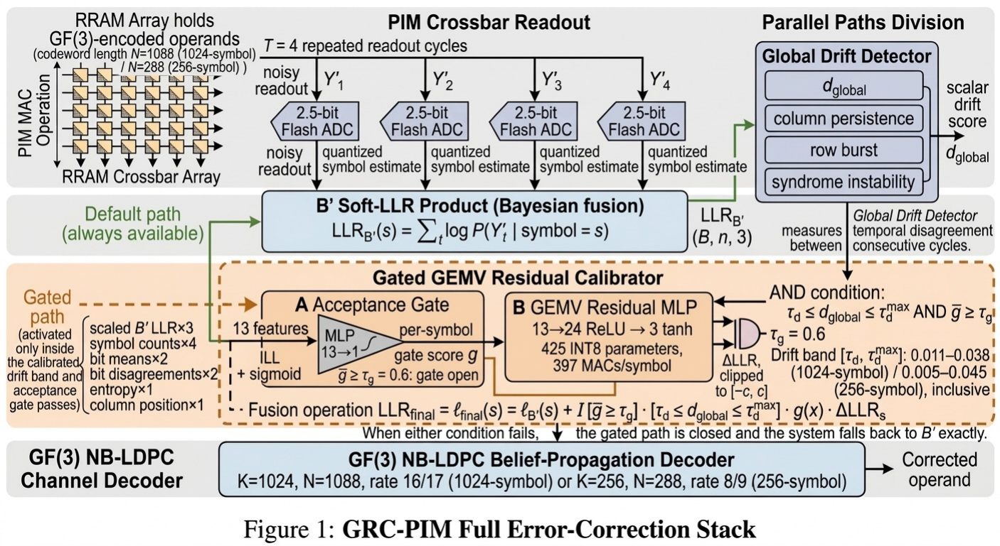
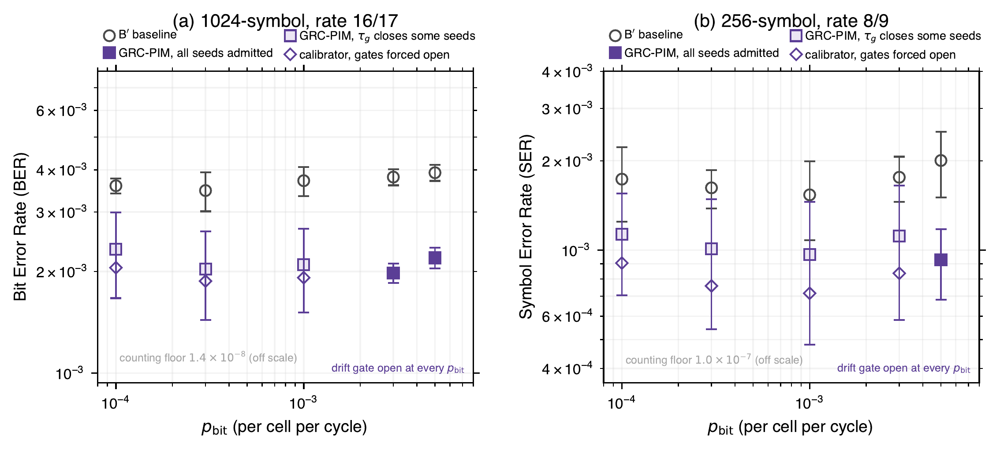
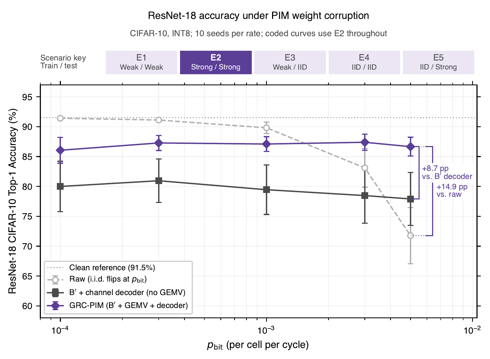

# GRC-PIM

**Gated Residual Calibration for soft-decision error correction in RRAM processing-in-memory (PIM).**

Public code, RTL and result data for the manuscript
*GRC-PIM: Drift-Gated GEMV-Reusing Residual Calibration for Soft-Decision Error Correction in Processing-in-Memory*.

GRC-PIM results are simulations or synthesis-based projections, not measurements of fabricated GRC-PIM silicon. The decoder reference in Figure 5 is a published 40 nm measurement.

**Start here:** [Check the published numbers](#check-the-published-numbers) without installing PyTorch, [install the simulator](#install) to run experiments, or [browse the figure and data index](DATA_MANIFEST.md).

## What it does

RRAM PIM arrays suffer conductance drift, which correlates the errors of repeated reads. GRC-PIM sits between the PIM readout and a GF(3) NB-LDPC channel decoder:

```
PIM readout (T = 4 cycles) → B′ soft-LLR product → gated GEMV residual → GF(3) BP decoder
```

- **B′** fuses the T reads into a per-symbol log-likelihood vector. It needs no training and is the default path.
- **GEMV residual calibrator**: a 425-parameter INT8 model (13 features per symbol) that adds a clipped correction to B′.
- **Gate**: the correction is applied only when the temporal-disagreement (drift) score lies inside a calibrated band, τ_d ≤ d_global ≤ τ_d^max, **and** the mean acceptance score clears its threshold, ḡ ≥ τ_g. Otherwise the output is exactly B′.

Deployed thresholds:

| Scale | τ_d | τ_d^max | τ_g |
|-------|-----|---------|-----|
| 1024-symbol, rate 16/17 | 0.011 | 0.038 | 0.6 |
| 256-symbol, rate 8/9 | 0.005 | 0.045 | 0.6 |

The drift band was placed on held-out validation streams (evaluation seeds 101–103). τ_g is a fixed design value.

## Results at a glance

E2 (matched strong drift), 10 seeds, 100,000 codewords per seed, 3 BP iterations, at p_bit = 5×10⁻³:

| Scale | B′ → GRC-PIM | Gain | Seeds admitted by the gates |
|-------|--------------|------|-----------------------------|
| 1024-symbol | BER 3.92×10⁻³ → 2.19×10⁻³ | 1.79 ± 0.08× | 10/10 |
| 256-symbol | SER 2.00×10⁻³ → 9.30×10⁻⁴ | 2.17 ± 0.13× | 10/10 |

Read these with their limits:

- **The gate has an in-distribution cost.** Over the five-point p_bit sweep it admits 46 of 50 seed × operating-point combinations at the 1024-symbol scale and 38 of 50 at the 256-symbol scale. A rejected combination returns B′ (gain exactly 1). Averaged over the sweep, the deployed gain is 1.79 ± 0.20× and 1.85 ± 0.45×; with both gates forced open it is 1.86 ± 0.09× and 2.12 ± 0.08×, and the calibrator improves on B′ at all 100 combinations.
- **Under mismatch (E5, i.i.d.-trained model on strong drift)** the acceptance gate rejects the correction at every tested point and the output equals B′. Ungated, the mismatched model costs 2.1–4.1% in SER at the 256-symbol scale for p_bit ≥ 10⁻³ and is neutral at the 1024-symbol scale.
- **Simpler fusions fall short.** A per-cycle discount (ρ = 0.9) gains 1.03–1.04×, and a linear head on the same features recovers roughly half of the GEMV gain.
- **The noise model is phenomenological**: bit-level injection with parameters chosen for order-of-magnitude consistency with published RRAM data, not fitted to devices.

Per-point values are in the result files indexed by [`DATA_MANIFEST.md`](DATA_MANIFEST.md).

## Check the published numbers

From the directory containing `figures/` and `pim_predecoder/`, run the following with Python 3.14. It reads the bundled JSON using only the standard library: no training, downloads or RTL tools. Each gain is the mean of ten **per-seed** B′/GRC-PIM ratios, not the ratio of two mean error rates.

```bash
python3 - <<'PY'
from pim_predecoder.result_data import aggregate_1024_e2, aggregate_256_e2, row_at_p

for metric, sweep in (("1024 BER", aggregate_1024_e2), ("256 SER", aggregate_256_e2)):
    row = row_at_p(sweep(), 5e-3)
    print(f"{metric}: gain {row.gain_seed_mean:.2f}x; gate open {row.n_open}/{row.n_seeds}")
PY
```

Expected output:

```text
1024 BER: gain 1.79x; gate open 10/10
256 SER: gain 2.17x; gate open 10/10
```

## Install

To **rerun** the experiments and tests, create a Python 3.14 virtual environment from this same directory. On Linux or macOS:

```bash
python3.14 -m venv .venv
source .venv/bin/activate
python -m pip install -r pim_predecoder/requirements.txt -r pim_predecoder/requirements-dev.txt
```

`requirements.txt` is the runtime set. `requirements-dev.txt` adds pytest and matplotlib; it does not include the runtime packages, so install both.

The GF(3) matrices and reference decoder RTL are vendored as regular files under `deps/NBLDPC_PIM/`. No submodule step is needed.

Optional tools:

| Tool | Needed for |
|------|------------|
| Icarus Verilog (`iverilog`, `vvp`) | RTL cosimulation tests and testbenches |
| `yosys` and the Nangate45 liberty file | Re-running the area synthesis (`pim_predecoder/rtl/run_synth.sh`) |
| `aihwkit` | Only the device-calibrated channel cross-check (`--channel aihwkit`). It may not provide wheels for the Python version used above; install it in a separate virtual environment and set `AIHW_PY` to that interpreter. The import is lazy, so nothing else needs it. |

## Quick check

```bash
python3 -m pim_predecoder.scripts.smoke
python3 -m pytest pim_predecoder/tests -m "not rtl"
python3 -m pytest pim_predecoder/tests -m rtl        # needs iverilog and vvp
```

`make -C pim_predecoder test-fast` and `test-rtl` wrap the same pytest commands. They use the active environment’s `python3` by default.

## Figures

The six PNGs in [`figures/`](figures/) are numbered as in the manuscript.

### Fig. 1: system architecture



| Block | Code |
|-------|------|
| Multi-cycle PIM noise (E1–E5) | `pim_predecoder/core/noise3d.py` |
| Encode and GF(3) BP decode | `pim_predecoder/core/codec.py` |
| B′ soft-LLR, GEMV calibrator and gates | `pim_predecoder/core/gemv_calibrator.py` |
| H/G matrices | `deps/NBLDPC_PIM/DAC_TEST/` |
| RTL reference | `pim_predecoder/rtl/`, `pim_predecoder/hw/` |

### Fig. 2: error rates under E2 strong drift



Ten-seed sweep at both code scales with the deployed thresholds. Filled squares mark points where all ten seeds are admitted; light squares mark points where the acceptance gate closes some seeds; open diamonds show the calibrator with both gates forced open.

Data: [`revision_n100k/recal/`](pim_predecoder/results/revision_n100k/recal/). The [headline check](#check-the-published-numbers) reads these files.

### Fig. 3: held-out calibration of cycle-discounted fusion


Weighting read cycle t by ρ^(t−1) is a one-parameter relaxation of the independence assumption behind B′ (ρ = 1 is B′). On held-out evaluation seeds 101–103 (10,000 codewords per point), the mean gain falls from 1.03× at ρ = 0.9 to 0.51× at ρ = 0.25 at the 1024-symbol scale, and from 1.04× to 0.24× at the 256-symbol scale. On the 100,000-codeword test sweep, ρ = 0.9 gains 1.034 ± 0.014× and 1.036 ± 0.045×.

Data: [held-out grid](pim_predecoder/results/revision_n100k/wbp/calib/). For the ten-seed test sweep, `wbp_formal()` reads dedicated WBP files where available and the WBP columns of the same-seed linear runs otherwise; see the [file index](DATA_MANIFEST.md).

### Fig. 4: gate behaviour across E1–E5


| ID | Train / test channel | Role |
|----|----------------------|------|
| E1 | weak / weak | Matched weak drift |
| E2 | strong / strong | Matched strong drift; every headline number refers to it |
| E3 | weak / i.i.d. | Fitted drift absent at test time |
| E4 | i.i.d. / i.i.d. | No temporal correlation to exploit |
| E5 | i.i.d. / strong | Mismatch; the case the acceptance gate exists for |

Channels are (p_drift, p_row_burst) per cycle: strong (5×10⁻³, 5×10⁻³), weak (5×10⁻⁴, 1×10⁻³), i.i.d. (0, 0).

This figure is a **single-seed diagnostic**: 1024-symbol scale, seed 1, 800 codewords, p_bit = 5×10⁻³, with a diagnostic lower drift threshold of 0.030 rather than the deployed band. Only E2 passes both gates (2.08× at this budget, which must not be compared with the ten-seed 1.79×). In E5 the drift score clears the threshold but the acceptance gate rejects the correction, so GRC-PIM equals B′.

```bash
python3 - <<'PY'
import json
from pathlib import Path
for s in ["E1", "E2", "E3", "E4", "E5"]:
    j = json.loads(Path(f"pim_predecoder/results/paper1024_{s}_gemv_gated.json").read_text())
    r = next(x for x in j["rows"] if x["p_bit"] == 5e-3)
    print(f"{s}: drift={r['drift_score']:.4f} gate={r['use_gemv']} "
          f"BER {r['Bp_post_BER']:.4g} -> {r['GEMV_post_BER']:.4g}")
PY
```

### Fig. 5: hardware cost


Two design points are reported because the area target (0.05 mm²) and the decoder's per-codeword latency (about 15 μs) are not met together.

| Metric | Config A: minimum area | Config B: throughput-matched |
|--------|------------------------|------------------------------|
| Datapath | 1 INT8 MAC, sequential | 3-stage pipeline, 280 multipliers as built (199 if time-shared) |
| Cycles per symbol (RTL simulation) | 401 | 2 in steady state |
| Latency per 1024-symbol codeword at an assumed 200 MHz | 2181 μs (145× the decoder) | 10.9 μs (0.73×) |
| Area, 28 nm projection | 0.020 mm² | 0.124–0.151 mm² shared; 0.167 mm² as built |
| Area, 40 nm projection (decoder node) | 0.040 mm², 5.0% of the decoder | 0.253 mm², 31.6% |

Area is `yosys` cell area against the open Nangate45 library, projected to the target node with an assumed 60% placement utilisation. No place-and-route or timing closure was performed, and 200 MHz is an assumed clock. Power is an analytical estimate for Config A only (about 0.4–0.8 mW active) and is not characterised for Config B. The decoder reference is the 40 nm prototype of Shi et al.

Code: `pim_predecoder/rtl/` (RTL, testbenches, `run_synth.sh`, `synth_area.json`) and `pim_predecoder/hw/`. Commands are in [`pim_predecoder/README.md`](pim_predecoder/README.md).

### Fig. 6: workload-scale accuracy translation (ResNet-18, CIFAR-10)



The key above the plot lists the E1–E5 scenarios with E2 highlighted: both coded curves use E2 error rates at every noise level.

This is a **two-stage translation, not an end-to-end run**. INT8 weights receive independent bit flips at the ten-seed mean post-decoding BER of each 1024-symbol E2 pipeline; the raw reference is flipped at p_bit alone, without drift or bursts. Error correlation and the GF(3)-symbol to INT8 mapping are discarded, so the percentage points are indicative.

At p_bit = 5×10⁻³: raw reference 71.8%, B′ + decoder 77.9%, GRC-PIM 86.6% Top-1 (clean INT8 reference 91.5%; 10 weight-corruption realisations per point). GRC-PIM is above B′ + decoder at all five tested points, and below the raw reference at the three lowest p_bit values, where the raw reference sees a milder channel.

The benchmark and its trained INT8 checkpoint are included; CIFAR-10 is not. The first run downloads CIFAR-10 through torchvision into `data/` at the repository root:

```bash
python3 -m pim_predecoder.bench_inference --n_seeds 10
```

This rewrites `pim_predecoder/results/inference_accuracy.json` and `.csv`.

## Reproduction ladder

| Level | Goal | How |
|-------|------|-----|
| 0 | Environment works | Quick check above |
| 1 | Inspect the bundled numbers | Snippets above; file index in [`DATA_MANIFEST.md`](DATA_MANIFEST.md) |
| 2 | Re-run one E2 point from a bundled checkpoint | Command below |
| 3 | Re-run the reported sweeps | `run_*.sh` scripts next to each result set; `experiments.gemv` per seed |
| 4 | RTL cosimulation and synthesis | [`pim_predecoder/README.md`](pim_predecoder/README.md) |

Level 2, one 1024-symbol E2 point at a reduced 2,000-codeword budget with the deployed thresholds:

```bash
python3 -m pim_predecoder.experiments.gemv \
  --matrix_info 1024 --matrix_rate 16_17 \
  --train_steps 600 --train_batch 48 --seed 1 \
  --n_codewords 2000 --p_bits 5e-3 \
  --drift_score_threshold 0.011 --drift_score_max 0.038 --model_gate_threshold 0.6 \
  --out_json E2_1024_s1_check.json --label E2_check
```

With these training arguments the seed-1 checkpoint in `pim_predecoder/_cache/` is reused; other values train a new model. A 2,000-codeword run will not reproduce the 100,000-codeword figures exactly.

Level 3 is expensive: the headline tables are 10 seeds × 5 operating points × 100,000 codewords per code scale. Each result JSON records the channel, seed, scale and threshold settings of the run that produced it. Bit-identical regeneration across machines, thread counts or library versions is not guaranteed.

## Using this repository

GRC-PIM is a reliability layer between PIM readout and a soft-decision decoder, not an inference framework.

| Direction | Entry point |
|-----------|-------------|
| ECC algorithm research: sweep p_bit, code scale, gates and baselines | `pim_predecoder/experiments/gemv.py`, `pim_predecoder/experiments/ablation.py` |
| Noise and drift studies: E1–E5, drift-rate sweep, threshold placement | `pim_predecoder/core/noise3d.py`, `pim_predecoder/results/revision_n100k/` |
| RTL integration: INT8 weight export, cosimulation with the NB-LDPC decoder RTL | `pim_predecoder/hw/`, `pim_predecoder/cosim/`, `pim_predecoder/rtl/` |
| System co-design: off-chip feature construction against on-chip GEMV and gating | [`pim_predecoder/hw/FEATURE_OFFLOAD.md`](pim_predecoder/hw/FEATURE_OFFLOAD.md) |
| Porting to another memory technology | Retrain on a new noise model and recalibrate all three thresholds |

`FEATURE_OFFLOAD.md` records a deliberate boundary: the 13 per-symbol features are built off-chip and streamed on `FEAT_IN`, while the RTL implements B′ accumulation, the drift score, the INT8 MLP and LLR output. Read it before integrating the RTL; skip it for Python-only simulation.

## Repository layout

```
.
├── README.md, DATA_MANIFEST.md, LICENSE, CITATION.cff
├── figures/                  # fig1.png … fig6.png
├── pim_predecoder/
│   ├── core/                 # codec, noise models, GEMV calibrator and gates
│   ├── experiments/          # gemv.py, ablation.py
│   ├── hw/ cosim/ rtl/       # hardware models, cosimulation, Verilog, synthesis script
│   ├── bench_inference.py    # ResNet-18 accuracy translation
│   ├── result_data.py        # aggregation of the bundled result files
│   ├── results/              # result JSON and the scripts that produced them
│   ├── _cache/               # trained checkpoints
│   └── tests/
└── deps/NBLDPC_PIM/          # vendored GF(3) matrices and reference decoder RTL
```

Not included: the manuscript sources and PDFs, the manuscript plotting scripts, patent materials, peer-review correspondence, and the CIFAR-10 dataset.

## Citation, license and third-party material

Cite the GRC-PIM manuscript and this software; metadata is in [`CITATION.cff`](CITATION.cff). The project is released under the [MIT License](LICENSE).

`deps/NBLDPC_PIM/` is redistributed unchanged from [NBLDPC_PIM](https://github.com/carabdis/NBLDPC_PIM) (Shi et al.); follow the upstream terms for that directory. CIFAR-10 and `aihwkit` are third-party and obtained separately.
